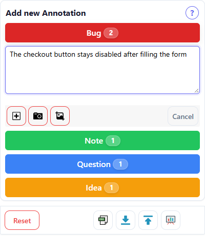
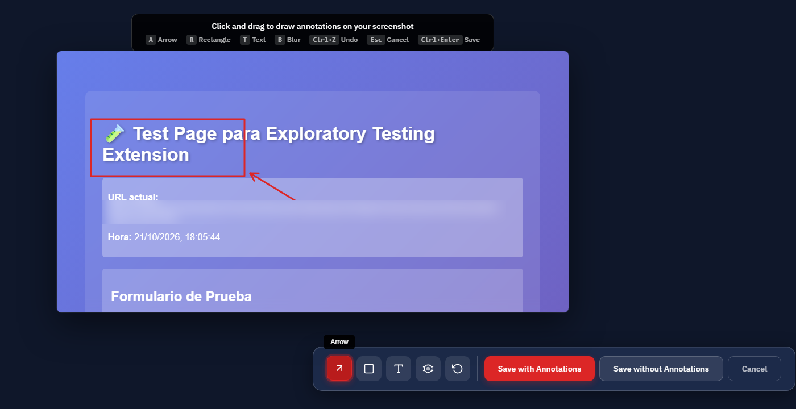
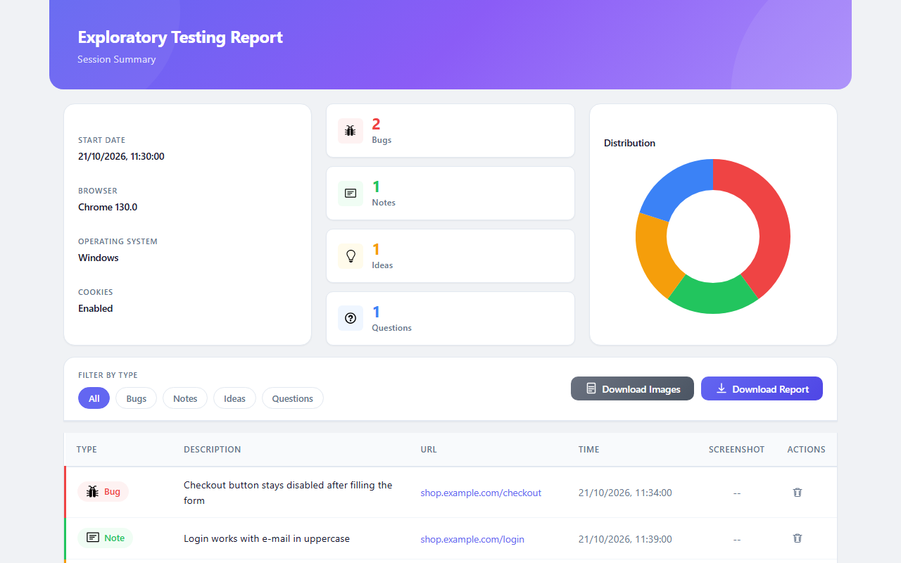
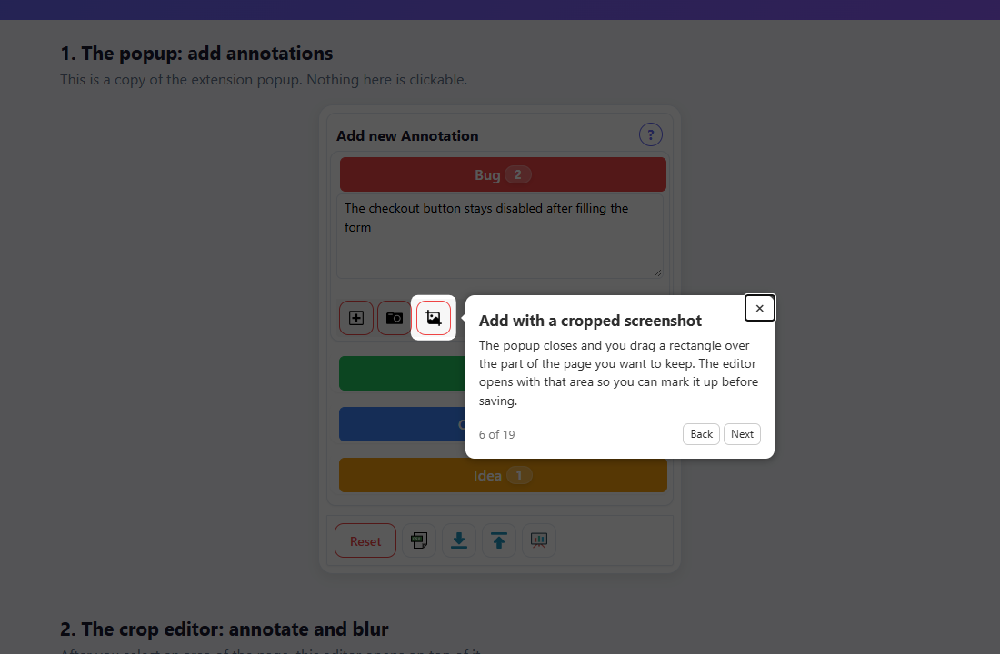

# A Chrome Extension for Exploratory Testing

A Chrome extension designed for making web exploratory testing easier. Record what you find while you explore a web page, with the URL and a screenshot attached, and review the whole session in a report.

Install from [Chrome Store](https://chrome.google.com/webstore/detail/exploratory-testing-chrom/khigmghadjljgjpamimgjjmpmlbgmekj)

## Features

- **Four annotation types**: Bugs, Notes, Questions and Ideas, each with a counter in the popup.
- **Screenshots without changing context**: add an annotation with no screenshot, with a screenshot of the visible tab, or with a cropped area of the page.
- **Annotation editor for cropped screenshots**: arrow, rectangle, text and **blur** (to hide sensitive data), with undo and keyboard shortcuts.
- **Automatic tracking**: the URL, time and browser information are saved with every annotation.
- **Session report**: statistics per type, distribution chart, filter by type, annotations table and delete.
- **Download the report** as a standalone HTML file that works offline, or all screenshots as a ZIP.
- **Export and import sessions**: export to JSON or CSV, and import a JSON session to continue it later.
- **Interactive tutorial**: a guided tour that opens the first time you use the extension and can be reopened from the **?** button.
- **Keyboard shortcuts** in the description box: `Ctrl + Enter` adds the annotation, `Shift + Enter` adds it with a screenshot.

## Screenshots

**Annotate any thought while you test and take screenshots without changing context**



**Crop, annotate and blur the screenshot**



**View session results in a report**



**Learn the features with the built-in tutorial**



## Tutorial

The extension opens an interactive tutorial the first time you open its popup. It covers adding annotations (with and without screenshots), cropping with description and blur, viewing the report, and exporting or importing a session. To see it again, click the **?** button at the top right of the popup.

The tour is built with [Driver.js](https://driverjs.com/), bundled in `lib/driverjs/` (no CDN). The page is `tutorial.html`, with the steps in `js/tutorial.js`.

## Development and Testing

Plain JavaScript, no bundler and no runtime npm dependencies: the repository root is the extension. [AGENTS.md](./AGENTS.md) has the architecture, conventions and the full list of commands.

### Project Setup

1. **Prerequisites**: [Node.js](https://nodejs.org/) 20 (includes npm).
2. **Clone the repository**:
   ```bash
   git clone https://github.com/morvader/ExploratoryTestingChromeExtension.git
   cd ExploratoryTestingChromeExtension
   ```
3. **Install development dependencies** (Jest, Playwright):
   ```bash
   npm install
   npx playwright install chromium
   ```
4. **Load the extension**: open `chrome://extensions`, enable *Developer mode*, choose *Load unpacked* and select the repository folder.

### Running Tests

| Command | What it runs |
|---------|--------------|
| `npm test` | Jest unit tests (`test/spec/`) |
| `npm run test:e2e` | Playwright smoke and basic functionality |
| `npm run test:e2e:all` | Full Playwright suite (same as CI) |
| `npm run test:all` | Unit tests plus the full E2E suite |

### Release package

On Windows, `.\genetareZip.ps1` creates `ETExtension-<timestamp>.zip` with the runtime files only, ready to upload to the Chrome Web Store.

---
_PS: I'm not a web designer, so any help with web design or UX will be appreciated._

twitter: @morvader
